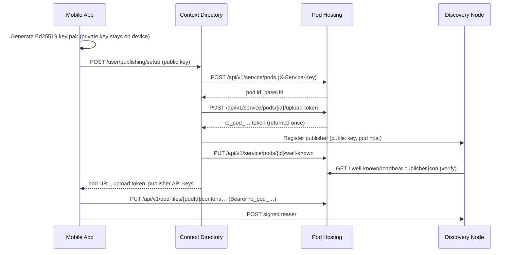

## Overview

A **local account** is a roadbeat account that lives only in the mobile app — there is no Studio behind it. To publish, such an account still needs a Content Pod for the full content, a publisher identity on the Discovery Nodes, and a signing key.

Since **v1.2.0**, Pod Hosting offers everything needed for this:

- a **service API** (`/api/v1/service/pods`) through which the **Context Directory** creates and manages a free-tier pod on the user's behalf,
- **scoped upload tokens** (`rb_pod_…`) that let the app upload files directly into its own pod (`/api/v1/pod-files/{podId}/{path}`),
- a **`/.well-known/roadbeat-publisher.json`** document on the pod, which Discovery Nodes use to verify the publisher without a domain of its own.

<Callout kind="info">
  **The Context Directory is not in the content path.** It sets up and manages the pod, but it never sees content, media, or the private signing key. The app uploads bundles straight to the pod and pushes signed teasers straight to the Discovery Nodes.
</Callout>

## How It Works



## Free Tier

Pods provisioned by the Context Directory use the same limits as Studio's free pod:

| Limit | Value |
|-------|-------|
| Storage quota | 500 MB |
| Content items | 200 |
| Maximum file size | 25 MB per upload |
| Pod owner | `cd:{ownerRef}` (the Context Directory user id) |
| `provisionedBy` | `context-directory` |

A content item is counted for every `content/{type}/{slug}/index.json` in the pod. Replacing an existing item does not count against the item limit; uploading the 201st new item returns `413 Item limit reached (200)`.

## Service API (Context Directory)

The service API is used only by platform services. Every request carries the shared service key in the `X-Service-Key` header — see [Authentication](/api-reference/authentication#service-key).

| Method | Endpoint | Description |
|--------|----------|-------------|
| `POST` | `/api/v1/service/pods` | Create a free-tier pod for an owner |
| `GET` | `/api/v1/service/pods/{id}` | Pod status and usage |
| `POST` | `/api/v1/service/pods/{id}/upload-token` | Issue a scoped upload token (returned once) |
| `PUT` | `/api/v1/service/pods/{id}/well-known` | Write `/.well-known/roadbeat-publisher.json` |
| `POST` | `/api/v1/service/pods/{id}/suspend` | Suspend: uploads stop, all upload tokens are revoked |
| `POST` | `/api/v1/service/pods/{id}/resume` | Resume a suspended pod |
| `DELETE` | `/api/v1/service/pods/{id}` | Delete the pod and all its files |

Only pods created through this API are visible here — a pod created by a Studio user cannot be read or changed with the service key.

### Create a Pod

```bash
curl -X POST https://pods.roadbeat.net/api/v1/service/pods \
  -H "X-Service-Key: $POD_HOSTING_SERVICE_KEY" \
  -H "Content-Type: application/json" \
  -d '{
    "ownerRef": "3f2b9c1e-7d4a-4f0e-9b8a-2c6d1e5f7a90",
    "name": "Recipes by Anna"
  }'
```

```json
{
  "id": "8a1c4e2f-5b6d-4c3a-9e8f-1a2b3c4d5e6f",
  "subdomain": "p-4f9a2c7e1b",
  "baseUrl": "https://p-4f9a2c7e1b.pods.roadbeat.net",
  "status": "active",
  "quotaBytes": 524288000,
  "usedBytes": 0,
  "maxItems": 200
}
```

- `ownerRef` must be 8–64 characters (letters, digits, hyphens).
- `subdomain` is optional; without it a random `p-<10 hex>` subdomain is generated.
- Each owner can have one pod. A second request returns `409 Pod already exists` with the existing `podId`.

### Issue an Upload Token

```bash
curl -X POST https://pods.roadbeat.net/api/v1/service/pods/$POD_ID/upload-token \
  -H "X-Service-Key: $POD_HOSTING_SERVICE_KEY" \
  -H "Content-Type: application/json" \
  -d '{ "ttlDays": 30, "revokeOthers": true }'
```

```json
{
  "token": "rb_pod_Jx3k9…",
  "expiresAt": "2026-12-07T14:36:58.000Z"
}
```

- `ttlDays` defaults to **30** and is capped at **90**.
- `revokeOthers: true` revokes all earlier tokens of the pod first (e.g. after a device change).
- The token is returned **once**; Pod Hosting stores only its SHA-256 hash.

## Uploading Files (App)

The app writes files into its pod with the upload token. The request body is the raw file — no multipart, no JSON wrapper.

<Steps>
  <Step title="Upload the content bundle">
    ```bash
    curl -X PUT https://pods.roadbeat.net/api/v1/pod-files/$POD_ID/content/recipe/apple-pie/index.json \
      -H "Authorization: Bearer $UPLOAD_TOKEN" \
      -H "Content-Type: application/json" \
      --data-binary @index.json
    ```

    ```json
    {
      "path": "content/recipe/apple-pie/index.json",
      "url": "https://p-4f9a2c7e1b.pods.roadbeat.net/content/recipe/apple-pie/index.json",
      "bytes": 2817
    }
    ```

    An `index.json` must be valid JSON. Its `title` (or `data.title`, `name`, `data.name`) is recorded as the item title.
  </Step>
  <Step title="Upload the rendered page and media">
    ```bash
    curl -X PUT https://pods.roadbeat.net/api/v1/pod-files/$POD_ID/content/recipe/apple-pie/index.html \
      -H "Authorization: Bearer $UPLOAD_TOKEN" \
      -H "Content-Type: text/html" \
      --data-binary @index.html

    curl -X PUT https://pods.roadbeat.net/api/v1/pod-files/$POD_ID/content/recipe/apple-pie/assets/hero.jpg \
      -H "Authorization: Bearer $UPLOAD_TOKEN" \
      -H "Content-Type: image/jpeg" \
      --data-binary @hero.jpg
    ```
  </Step>
  <Step title="Unpublish">
    Delete the item's files. Deleting `index.json` also removes the item from the pod's content list.

    ```bash
    curl -X DELETE https://pods.roadbeat.net/api/v1/pod-files/$POD_ID/content/recipe/apple-pie/index.json \
      -H "Authorization: Bearer $UPLOAD_TOKEN"
    ```
  </Step>
</Steps>

### Path Rules

| Rule | Result if violated |
|------|--------------------|
| Only `A–Z a–z 0–9 . _ - /`, at most 300 characters | `400 Invalid file path` |
| No `..`, `.` or empty path segments | `400 Invalid file path` |
| No segment may start with a dot (e.g. `.well-known`) | `403 Reserved path` |
| File at most 25 MB | `413 Files are limited to 26214400 bytes` |
| Storage quota not exceeded | `413 Storage quota exceeded` |
| Item limit not exceeded (new items only) | `413 Item limit reached (200)` |

<Callout kind="tip">
  Dot-paths are reserved for the platform: only the service API writes `/.well-known/roadbeat-publisher.json`. An upload token can therefore never overwrite the publisher verification document.
</Callout>

### CORS

The pod-file endpoints accept requests from **any origin** (`Access-Control-Allow-Origin: *`, methods `PUT, DELETE, OPTIONS`, headers `Authorization, Content-Type`). They are authenticated by the bearer token only — no cookies — so they behave like a presigned upload URL. This is required because the app's WebView origin varies (`capacitor://localhost`, `https://localhost`, development servers). Preflight responses are cached for 24 hours.

## Publisher Verification Document

Individuals have no domain they could verify with a DNS record. Instead, the Discovery Node verifies the **pod host**: the Context Directory writes a document to the pod, and the Discovery Node fetches it from `https://{subdomain}.pods.roadbeat.net/.well-known/roadbeat-publisher.json`.

```bash
curl -X PUT https://pods.roadbeat.net/api/v1/service/pods/$POD_ID/well-known \
  -H "X-Service-Key: $POD_HOSTING_SERVICE_KEY" \
  -H "Content-Type: application/json" \
  -d '{
    "publicKey": "MCowBQYDK2VwAyEA…",
    "status": "active",
    "publishers": [
      { "nodeUrl": "https://discovery.roadbeat.net", "publisherId": "pub_7f3a…" }
    ]
  }'
```

The resulting document:

```json
{
  "version": 1,
  "podHost": "p-4f9a2c7e1b.pods.roadbeat.net",
  "publicKey": "MCowBQYDK2VwAyEA…",
  "status": "active",
  "publishers": [
    { "nodeUrl": "https://discovery.roadbeat.net", "publisherId": "pub_7f3a…" }
  ],
  "updatedAt": "2026-11-07T16:51:18.000Z"
}
```

<ParamField body="publicKey" param-type="string" required="true">
  The publisher's current Ed25519 public key. A new key is only taken over by the Discovery Nodes together with a fresh proof of possession.
</ParamField>

<ParamField body="status" param-type="string" required="false">
  The owner's publishing status: `active` (default), `suspended`, or `deleted`. Any other value is written as `active`.
</ParamField>

<ParamField body="publishers" param-type="array" required="false">
  The Discovery Node registrations of this publisher: `{ nodeUrl, publisherId }`.
</ParamField>

The document is the **owner's voice towards the Discovery Nodes**: when a node syncs it, it applies the status — `suspended` hides the publisher's teasers, `active` restores them, `deleted` removes the publisher and all its teasers.

<Callout kind="alert">
  The document must stay reachable even while the pod is suspended — otherwise the Discovery Nodes cannot learn that the owner resumed publishing.
</Callout>

## Account Lifecycle

| Account event | Context Directory calls | Effect on the pod |
|---------------|-------------------------|-------------------|
| Key rotated (new device) | `PUT …/well-known` with the new `publicKey`, then `POST …/upload-token` with `revokeOthers: true` | Earlier upload tokens revoked; the new device gets a fresh token |
| Deletion scheduled (30-day grace period) | `POST …/suspend`, then `PUT …/well-known` with `status: suspended` | Status `suspended`; all upload tokens revoked; uploads return `403 Pod is suspended` |
| Deletion cancelled | `POST …/resume`, then `PUT …/well-known` with `status: active` | Status `active`; a new upload token must be issued |
| Account purged | `PUT …/well-known` with `status: deleted`, then `DELETE …/{id}` | Tokens revoked, all files removed, status `deleted` |

## Configuration

Pod Hosting needs three settings for this feature — see [Self-Hosting](/deployment/self-hosting#environment-variables):

| Variable | Description |
|----------|-------------|
| `POD_HOSTING_SERVICE_KEY` | Shared secret for `/api/v1/service/*`, at least 16 characters; must match the Context Directory's `POD_HOSTING_SERVICE_KEY`. Without it, the service API rejects every request. |
| `POD_FILES_ROOT` | Directory that holds one folder per pod (development: the static pod root served by `serve-static-pod.ts`) |
| `POD_PUBLIC_URL_TEMPLATE` | Public URL of a pod, `{subdomain}` is replaced (production: `https://{subdomain}.pods.roadbeat.net`) |

<Callout kind="info">
  Pod files are currently stored on the local file system under `POD_FILES_ROOT`. S3-compatible object storage for production will be added behind the same API — clients do not need to change.
</Callout>

## Related

<Columns cols={2}>
  <Card title="Studio Integration" icon="plug" href="/guides/studio-integration">
    How Studio provisions and publishes to pods server-side.
  </Card>
  <Card title="Pod Structure" icon="folder-tree" href="/architecture/pod-structure">
    The bundle format the app uploads, including `.well-known`.
  </Card>
</Columns>
