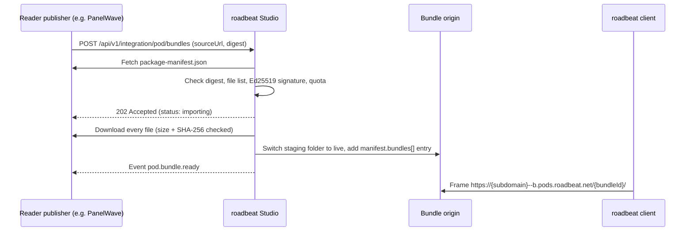

Some content is read in an **external reader** instead of on a page — an interactive comic in the PanelWave player, for example. Such an item names its reader in `digital_edition.reader` (Schema Registry content types `comic-release` and `comic-series`). Content Pods support these items in two ways:

<Columns cols={2}>
  <Card title="Read link" icon="external-link" href="/guides/reader-bundles#read-link-on-pod-pages">
    The item's pod page and embed card link to the reader.
  </Card>
  <Card title="Reader bundles" icon="package" href="/guides/reader-bundles#reader-bundles">
    The pod hosts a signed copy of the reader with the work, served from a bundle origin of its own.
  </Card>
</Columns>

## Read Link on Pod Pages

When an item has `digital_edition.reader.reader_url`, the generator links to the reader:

```json
{
  "digital_edition": {
    "reader": {
      "kind": "interactive_player",
      "format": "panelwave",
      "name": "PanelWave",
      "reader_url": "https://reader.example.org/works/north-wind"
    }
  }
}
```

| Output | What changes |
|--------|--------------|
| `index.html` | A **Read in PanelWave** button above the body — just **Read** when the reader has no `name` |
| `embed.html` | The card links to the reader instead of the pod page |
| Layout export | An `embed` region renders the same plain link, labelled with the region's localized label (default `Read`) followed by ` · {reader name}` — see [Layout Regions](/guides/studio-integration#layout-regions) |

Rules:

- Only `http` and `https` addresses **without credentials** (`user:password@…`) are linked. Any other value is ignored and the page renders without the link.
- Static pod pages **never frame** a reader. roadbeat clients (Web Client, Studio, the mobile app) frame readers that are registered in the Schema Registry themselves — see [External Readers](https://schema-registry-documentation.roadbeat.net/external-readers).

Custom templates use the same logic through two Handlebars helpers:

| Helper | Example | Output |
|--------|---------|--------|
| `readerLink` | `{{#with (readerLink content.data)}}…{{/with}}` | `{ url, name }` of the reader, or nothing |
| `readerUrlOr` | `{{readerUrlOr content.data seo.canonical_url}}` | The reader URL, otherwise the fallback |

```handlebars
{{#with (readerLink content.data)}}
  <p class="read-link"><a href="{{url}}" rel="noopener">Read{{#if name}} in {{name}}{{/if}}</a></p>
{{/with}}
```

## Reader Bundles

A reader's publisher can build a **signed package**: the reader (player) plus the work's files, with a `package-manifest.json` that lists every file with size and SHA-256 and carries an Ed25519 signature (PanelWave format: `panelwave-package/1`). A Content Pod can host such a package as a **bundle**, so the work is served from the publisher's own pod instead of the reader's servers.

roadbeat clients frame the bundle like any other approved reader URL — when the reader's registry entry allows pod bundles (`frame.allow_pod_bundles: true`).



<Callout kind="info">
  Content Pods serve **signed bundles only** — unsigned packages are refused. Bundles are imported by roadbeat Studio; pods of mobile-only accounts (Pod Hosting service pods) have no bundle import.
</Callout>

### Import through Studio

The reader's publisher imports a bundle through Studio's Integration API (scope `integration:publish`), only for items its integration manages:

```json
{
  "contentId": "00ec…",
  "sourceUrl": "https://reader.example.org/channel-packages/TOKEN/package-manifest.json",
  "digest": "<sha256 of package-manifest.json>",
  "reader": "panelwave"
}
```

`sourceUrl` may also be the package folder (ending in `/`). Its query string is sent with every file request, so a token in the source URL covers all files.

Studio checks synchronously — an error answers at once and nothing is downloaded:

<Steps>
  <Step title="Pod and content type">
    The pod is configured and active, and the item's content type is one the reader serves.
  </Step>
  <Step title="Reader entry">
    The reader's Schema Registry entry allows pod bundles and names the signing-key document (`frame.bundle_signature_keys`). The key URL **never** comes from the caller.
  </Step>
  <Step title="Digest">
    `package-manifest.json` (max. 8 MB) must hash to `digest`.
  </Step>
  <Step title="File list">
    At most 20,000 files, each at most 2 GB, relative paths without `..`, dot segments or duplicates.
  </Step>
  <Step title="Signature">
    The Ed25519 signature verifies against the reader's keys. An unknown key id refreshes the key document once.
  </Step>
  <Step title="Size">
    The listed bytes plus the manifest fit into the pod's free space within its tier — otherwise `413 POD_BUNDLE_TOO_LARGE` with `neededBytes` and `freeBytes`.
  </Step>
</Steps>

Then Studio answers `202` with the bundle in status `importing` and continues in the background:

- Every file is streamed into a staging folder (`.staging-{id}-…`), limited to its listed size, and its SHA-256 is compared after the last byte. Files whose path, size and hash match the live bundle are copied from it instead of downloaded (incremental updates).
- Only when **every** file verified does the staging folder replace the live bundle. A failed import leaves the live bundle untouched.
- The pod manifest gets the `bundles[]` entry; the pod's size and manifest signature are updated.
- The managing integration receives `pod.bundle.ready` or `pod.bundle.failed`.

| Situation | Answer |
|-----------|--------|
| Same `digest` as the live bundle | `unchanged: true` |
| Another import of the item still running | `409 BUNDLE_IMPORT_RUNNING` |
| Status, live URL, size, key id, last `error` (`code`, `message`) | `GET /api/v1/integration/pod/bundles/{bundleId}` |
| Remove files, manifest entry and record | `DELETE /api/v1/integration/pod/bundles/{bundleId}` |
| Will it fit? | `GET /api/v1/integration/publishing/targets` → `pod.bundles` (`supported`, `origin`, `maxFileBytes`, `quotaBytes`, `usedBytes`, `freeBytes`) |

Unpublishing, archiving or deleting the item removes its bundle.

<Expandable title="Egress rules of the import" default-open="false">
  All fetches — manifest, files and key document — are guarded:

  - `https` only, no credentials in URLs, no `localhost` or `*.local`
  - Every address the host resolves to is checked **in the socket's DNS lookup** against private, loopback, link-local, CGNAT, ULA, multicast and metadata ranges — no gap between check and request (DNS rebinding)
  - Redirects only on the same scheme, host and port (max. 3)
  - Bodies are capped: manifest 8 MB, keys 256 KB, files their listed size

  `WEBHOOK_ALLOW_PRIVATE_TARGETS=true` opts private targets and `http` in for self-hosted and development setups.
</Expandable>

## Bundle Origin

A reader's script runs with `allow-scripts allow-same-origin`. So bundles must **never share an origin** with the pod's own pages or dynamic features: they live in a root of their own and are served from a host of their own that serves nothing else.

| | Pod | Bundle origin |
|---|---|---|
| Production | `https://{subdomain}.pods.roadbeat.net/` | `https://{subdomain}--b.pods.roadbeat.net/{bundleId}/` |
| Development | `http://localhost:3403/{orgSlug}/` (`pnpm serve:static-pod`) | `http://localhost:3405/{orgSlug}/{bundleId}/` (`pnpm serve:bundles`) |
| Files | `dev-pods/static/{orgSlug}/`, server `/var/www/pod` | `dev-pods/bundles/{orgSlug}/{bundleId}/`, server `/var/www/bundles` |

A pod without a subdomain has no bundle origin.

### Response Headers

The bundle origin sends these headers (`bundleResponseHeaders` in `@roadbeat/production-readiness`; the Caddy site of provisioned pod servers mirrors them):

| Header | Value |
|--------|-------|
| `Content-Security-Policy` | `frame-ancestors 'self' https://roadbeat.net https://*.roadbeat.net https://localhost capacitor://localhost` — instead of `X-Frame-Options`, which would forbid the frame |
| `Access-Control-Allow-Origin` | `*` — hosts may read `panelwave.json`, `listing.json` and media |
| `Access-Control-Allow-Methods` | `GET, HEAD, OPTIONS` |
| `Access-Control-Allow-Headers` | `Range` |
| `Access-Control-Expose-Headers` | `Content-Length, Content-Range, Accept-Ranges` |
| `Accept-Ranges` | `bytes` — seeking in audio and video |
| `X-Content-Type-Options` | `nosniff` |
| `Referrer-Policy` | `strict-origin-when-cross-origin` |
| `Cache-Control` | `no-cache` for `.html`, `.json` and `.webmanifest` (bundle paths stay the same across updates); `public, max-age=3600` for everything else |
| `Content-Type` | Explicit types, e.g. for `mjs`, `wasm`, `webp`, `avif`, `woff2`, `m4a`, `opus`, `mp4`, `vtt` |

Paths with a dot segment — staging folders and old copies during a switch — answer `404`. The pod's own site keeps `X-Frame-Options: SAMEORIGIN`.

Use the same headers in a web server of your own:

```typescript
import { bundleResponseHeaders, parseFrameAncestors } from '@roadbeat/production-readiness';

// "'self' https://roadbeat.net https://*.roadbeat.net" — comma or space separated
const frameAncestors = parseFrameAncestors(process.env.BUNDLE_FRAME_ANCESTORS);

const headers = bundleResponseHeaders('/6f9b2c/index.html', { frameAncestors });
// → CSP frame-ancestors, CORS, Accept-Ranges, Cache-Control: no-cache, Content-Type: text/html
```

`parseFrameAncestors` returns `undefined` — so the roadbeat defaults apply — when the value is empty or contains one unsafe token (`;`, `"`, `<`, `>`).

<Callout kind="tip">
  roadbeat clients approve a bundle URL for framing only when the reader's entry has `allow_pod_bundles` and the host matches `POD_BUNDLE_DOMAIN_PATTERNS` (default `*--b.pods.roadbeat.net`). The `*` matches one label without dots, so a pod's own host never matches.
</Callout>

## Manifest Entry

Every bundle has an entry in the pod's `manifest.json` (type `PodBundleEntry` in `@roadbeat/content-pod-generator`):

```json
{
  "bundles": [
    {
      "id": "6f9b2c",
      "content_id": "00ec41",
      "reader": "panelwave",
      "url": "https://north--b.pods.roadbeat.net/6f9b2c/",
      "path": "6f9b2c/",
      "bytes": 641230000,
      "file_count": 812,
      "digest": "<sha256 of the signed package-manifest.json>",
      "signature_ref": {
        "key_id": "pw-2026-11",
        "keys_url": "https://reader.example.org/.well-known/panelwave-keys.json"
      },
      "updated_at": "2026-11-19T19:12:00.000Z"
    }
  ]
}
```

| Field | Description |
|-------|-------------|
| `id` | Bundle id — the first path segment on the bundle origin |
| `content_id` | The content item the bundle belongs to |
| `reader` | Schema Registry reader id, e.g. `panelwave` |
| `url` / `path` | Public address on the bundle origin / path below the bundle root |
| `bytes` / `file_count` | Size and number of files — the bytes count toward the pod's storage quota |
| `digest` | SHA-256 of the bundle's signed `package-manifest.json` |
| `signature_ref` | Signing key id and the reader's key document |
| `updated_at` | Time the current version went live |

The bundle's own `package-manifest.json` is served with it, so anyone can re-check the files against the signature.

## Serving Bundles

<Tabs>
  <Tab title="Development" icon="terminal">
    The dev bundle origin serves `dev-pods/bundles/{orgSlug}/{bundleId}/` with the production headers:

    ```bash
    pnpm serve:bundles
    # Bundle origin (Content Pod reader bundles)
    # URL:     http://localhost:3405/{orgSlug}/{bundleId}/
    ```

    | Variable | Default | Description |
    |----------|---------|-------------|
    | `BUNDLE_POD_PORT` | `3405` | Port of the dev bundle origin |
    | `CONTENT_POD_BUNDLES_PATH` | `dev-pods/bundles` | Bundle root |
    | `BUNDLE_FRAME_ANCESTORS` | `'self'`, `http://localhost:4200` (Studio), `http://localhost:3601` (Web Client), `http://localhost:4201` (mobile web build), `https://localhost`, `capacitor://localhost` | Origins allowed to frame bundles |

    Point Studio and the clients at it:

    ```bash
    # Studio (.env)
    CONTENT_POD_BUNDLES_PATH=../content-pod/dev-pods/bundles
    POD_BUNDLE_PUBLIC_URL_TEMPLATE=http://localhost:3405/{orgSlug}

    # Studio / Web Client consumer backends (ignored in production)
    EXTERNAL_READER_DEV_ORIGINS=http://localhost:3405
    ```

    `GET /_health` reports the root, port and frame ancestors.
  </Tab>

  <Tab title="Provisioned pod server" icon="server">
    Static and dynamic pod servers from the [Cloud Provisioner](/guides/cloud-provisioning) get a second Caddy site for the bundle origin:

    - Root `/var/www/bundles` (created next to `/var/www/pod`)
    - Host derived from the pod domain: `north.pods.roadbeat.net` → `north--b.pods.roadbeat.net`
    - The headers above, dot paths answer `404`, gzip/zstd compression

    A custom pod domain has no derived bundle host. When you generate the cloud-init yourself, set it explicitly:

    ```typescript
    import { getCloudInitTemplate } from './cloud/cloud-init.templates.js';

    const userData = getCloudInitTemplate('content-pod-static', {
      domain: 'comics.example.org',
      bundleDomain: 'bundles.comics.example.org',        // false = no bundle origin
      bundleFrameAncestors: ["'self'", 'https://roadbeat.net', 'https://*.roadbeat.net'],
    });
    ```

    The bundle host's DNS record must point at the server so Caddy can obtain its certificate.
  </Tab>

  <Tab title="Own storage" icon="hard-drive">
    An organization can serve bundles from its own S3-compatible bucket or SFTP server — Studio storage target role `bundles`. Its public address becomes the bundle origin.

    - Each version is uploaded, streamed, under `{bundleId}/{digest16}/` — pages and JSON `no-cache`, everything else `immutable`. Only after the upload does Studio switch the record and manifest entry; the previous version is deleted afterwards.
    - The storage check requires a JavaScript MIME type for `.mjs`, `Content-Security-Policy: frame-ancestors`, `https`, and an origin of its own.
    - A plain bucket cannot send a CSP header — put a CDN or web server in front of it (e.g. Caddy with the headers above).

    See [Own Storage for Studio Pods](/guides/storage-providers#own-storage-for-studio-pods).
  </Tab>
</Tabs>
